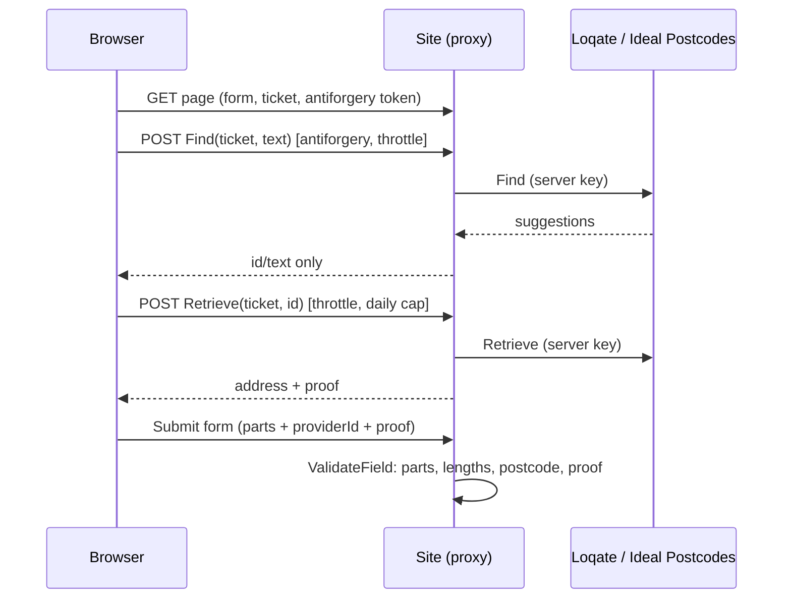

# Design: Address lookup (Forms field type)

| | |
|---|---|
| Package | `Umbraco.Community.AddressLookup` (NuGet ID free: `v3-flatcontainer` returned 404 on 2026-11-04 [verified]) |
| Owner | Pascal Meyer (`PascalA94`) |
| Size | M-, about 7-10 h agent time (Ideal Postcodes added to the MVP on 2026-11-04) |
| Lines | **Both from the start**: `17.x` on CMS `[17.8.0, 18.0.0)` + Forms `[17.6.2, 18.0.0)`, `18.x` on CMS `[18.3.0, 19.0.0)` + Forms `[18.2.2, 19.0.0)`. One codebase, both packed from one commit |
| Status | Design for the first release |
| Inputs | The scope note, the portfolio rules, the Umbraco pitfalls reference and the sibling package's house style; structure-only reviews of existing agency Forms address fields |

Tags: **[verified]** fetched or read this session at the cited source; **[unverified]** recalled or inferred, check while building; **[DATED]** true on 2026-11-04 and likely to move.

---

## 0. What was verified (2026-11-04)

**Umbraco Forms field type API.** Reflected from the restored `Umbraco.Forms.Core.dll` at **17.6.2 and 18.2.2** (`~/.nuget/packages`). Both are identical for everything below [verified].

| Fact | Source |
|---|---|
| Base class `Umbraco.Forms.Core.FieldType`. Settable: `Id`, `Name`, `Alias`, `Description`, `Icon`, `Category`, `DataType`, `SortOrder`, `SupportsMandatory`, `MandatoryByDefault`, `SupportsRegex`, `SupportsPreValues`, `RenderInputType`, `FieldTypeViewName`, `EditView`, `PreviewView` | reflection, both versions |
| Virtuals: `ProcessSubmittedValue(Field, IEnumerable<object>, HttpContext)`, `ConvertToRecord(...)`, `ConvertFromRecord(Field, IEnumerable<object>)`, `ValidateField(Form, Field, IEnumerable<object>, HttpContext, IPlaceholderParsingService, IFieldTypeStorage)` returning `IEnumerable<string>` (a 7-arg overload adds `List<string> errors`), `GetConfigurationErrors()`, `RequiredJavascriptFiles(Field)`, `RequiredCssFiles(Field)` | reflection, both versions |
| Registration: `builder.WithCollectionBuilder<FieldCollectionBuilder>().Add<T>()` in an `IComposer` | [docs: Adding a field type](https://docs.umbraco.com/umbraco-forms/developer/extending/adding-a-fieldtype) |
| Front-end view `Views/Partials/Forms/Themes/default/FieldTypes/FieldType.{Name}.cshtml`, model `Umbraco.Forms.Web.Models.FieldViewModel`, settings through `Model.GetSettingValue<T>(alias, default)` | same page |
| Settings: `[Setting("Name", Description=..., View="Umb.PropertyEditorUi.TextBox", DisplayOrder=n)]` on `public virtual string?` properties. `View` is a backoffice property-editor UI alias | same page |
| New backoffice preview: a `formsFieldPreview` manifest whose alias matches `PreviewView`, an element extending `FormsFieldPreviewBaseElement` from `@umbraco-forms/backoffice`, registered through a `backofficeEntryPoint` | same page |
| `DataType` values: `String`, `LongString`, `Integer`, `DateTime`, `Bit` | same page |
| Latest stable **Forms 17.6.2 and 18.2.2** (27 Oct 2026). `Umbraco.Forms.Core` 18.2.2 needs `Umbraco.Cms.Web.Common [18.2.0, 19.0.0)`; `Umbraco.Forms.Core.Providers` 17.6.2 needs `Umbraco.Cms.Web.Common [17.6.0, 18.0.0)` [DATED] | [nuget.org/packages/Umbraco.Forms](https://www.nuget.org/packages/Umbraco.Forms), cached nuspecs |

Not confirmed, so S1 checks them: theme fallback when a site uses a custom theme, Razor views shipped in an RCL, and how entries, CSV export and email placeholders show a field's stored value [unverified].

**Loqate** (docs fetched; the fetch tool summarises, so error texts are close paraphrase):

| Fact | Source |
|---|---|
| Find: `https://api.addressy.com/Capture/Interactive/Find/v1.20/json6.ws`. Params `Key`, `Text`, `Container`, `IsMiddleware`, `Origin`, `Countries`, `Limit` (default 10), `Language`, `Bias`. Items `Id`, `Type`, `Text`, `Highlight`, `Description`. **No credit used** | [find.md](https://docs.loqate.com/api-reference/address-capture/find.md) |
| Drill-down: `Type` other than `Address` (Container, Postcode, Street, Building...) means calling Find again with `Container=Id` | same |
| Retrieve: `.../Capture/Interactive/Retrieve/v1.30/json6.ws`, params `Key`, `Id`. Items include `Company`, `Line1-5`, `City`, `Province`, `PostalCode`, `CountryIso2`, `CountryName`, `Label`. **Uses credit** | [retrieve.md](https://docs.loqate.com/api-reference/address-capture/retrieve.md) |
| Errors are a row of `Error`, `Description`, `Cause`, `Resolution`. Generic codes are under 100, endpoint-specific ones 1000+. Codes: 2 unknown key, 3 out of credit, 4 IP not allowed, 5 URL not allowed, 8 key daily limit, 10 surge protector, 14 too many Finds without Retrieves, 16 key expired, 17 per-user limit, -1 unknown | [common-errors.md](https://docs.loqate.com/api-reference/common-errors.md) |
| Each key has URL and IP restrictions and a daily lookup limit | [create-an-api-key.md](https://docs.loqate.com/loqate-basics/create-an-api-key.md) |
| Capture JS v4: `https://api.addressy.com/js/address-4.05.js` + `https://api.addressy.com/css/address-4.05.css`, `new pca.Address(fields, { key })`. The key is visible in the page; the URL restriction protects it | [sdk.md](https://docs.loqate.com/our-services/address-capture/sdk.md) |
| JSON shape of an error item inside `Items` | [unverified] |

**Ideal Postcodes** (OpenAPI 4.12.0 and the guides):

| Fact | Source |
|---|---|
| Autocomplete `GET https://api.ideal-postcodes.co.uk/v1/autocomplete/addresses?query=` (max 150 chars), with `api_key`, `limit`, `context`, filters and biases. Response `result.hits[{id, suggestion, urls}]`. **Free**, but heavy autocomplete with no paid follow-up can get a key throttled | [openapi.yaml](https://app.unpkg.com/@ideal-postcodes/openapi@4.12.0/files/dist/openapi.yaml) |
| Resolve `GET /v1/autocomplete/addresses/{id}/gbr` is **paid**. Its field list (`line_1-3`, `post_town`, `county`, `postcode`, `country`, `udprn`, `uprn`, `organisation_name`) | schema link [unverified] |
| Rate limit headers `X-RateLimit-*`, 3000 requests per 5 min | openapi.yaml |
| Key controls: allowed URLs (Referer/Origin, browser only), a daily limit per key, a per-IP daily limit (server use needs the `IDPC-Source-IP` header) | [api-key-secure.md](https://docs.ideal-postcodes.co.uk/docs/guides/api-key-secure.md) |
| Errors: 4010 invalid key, 4011 URL not allowed, 4020 balance depleted, 4021 lookup limit reached, 4048 address not found, 4291 too many requests, 5001/5002 server | [error-codes](https://docs.ideal-postcodes.co.uk/docs/guides/error-codes) |
| Test key `iddqd` costs no lookups; postcode `ID1 1QD` succeeds, `ID1 CLIP` gives 4020, `ID1 CHOP` gives 4021 | openapi.yaml |
| Auth header form `Authorization: IDEALPOSTCODES api_key="..."` | [unverified]: the package sends `api_key` in the query string, which is documented |

**Evidence from existing Forms address fields** (file names and structure only): one Capture v3 field with the key in the browser, one Capture v4 field, one server-proxy field with a stub provider, no app-level rate limit and separate sibling fields, and one Ideal Postcodes field with the key in a `data-sitekey` attribute. The sibling-field design lost submitted addresses when an editor left out a sibling. This design keeps every part inside one field, so that can't happen.

---

## 1. Intent and goals

One Umbraco Forms field, "Address lookup". A visitor types a postcode or part of an address, picks a result and gets a structured address. They can always type it in by hand.

**Goals (1.0)**
- Providers: **Loqate** and **Ideal Postcodes** (Pascal, 2026-11-04), plus a **Stub** for dev and test, behind `IAddressLookupProvider`.
- **Proxy mode (default):** the browser only talks to the site, and the key stays on the server.
- **Capture mode (optional, Loqate only):** Loqate Capture v4 in the browser with a separate, URL-restricted key.
- A structured stored value with server-side validation on submit.
- Accessible combobox (WCAG 2.2 AA) in proxy mode, and a manual-entry path that works without JavaScript.
- A README migration section for sites with a hand-built field.

**Non-goals (1.0)**
- getAddress.io (later, behind the same interface), Ideal Postcodes' client-side Address Finder, a content property editor, and address cleansing or batch validation.
- Converting old entries from a hand-built field.
- Distributed (multi-server) rate limiting. Limits are per instance (5.2).

**Anti-goals**
- Never log a query, a suggestion, an address, a provider ID or a visitor IP.
- Never send the server key to the browser.

---

## 2. Constraints

- **Both lines**, using 15's pattern: `eng/lines.txt` = `17`, `18`. `UmbracoMajor` sets `UMBRACO_17` or `UMBRACO_18`, `UmbracoRange`, `FormsRange` and `NuGetLockFilePath` = `packages.$(UmbracoMajor).lock.json`. Version `$(UmbracoMajor).$(PackageMinor).$(PackagePatch)`. CI runs four legs (2 lines × floor and latest).
- The Forms API is the same on both lines [verified], so `#if` blocks are not expected.
- `net10.0` **Razor class library**. References: `Umbraco.Cms.Web.Website` at `UmbracoRange`, `Umbraco.Forms.Core` and `Umbraco.Forms.Web` at `FormsRange`. Forms floors 17.6.2 and 18.2.2 (the 27 Oct round).
- Static assets come from `wwwroot` under `_content/Umbraco.Community.AddressLookup/`. Both the front-end script and the backoffice preview element are hand-written ES modules, with **no client build and no npm dependency**. The preview imports `@umbraco-forms/backoffice` through the backoffice import map [unverified, S2].
- Pitfalls: P1/P2 [Critical] (providers are singletons over `IHttpClientFactory` and `IOptionsMonitor`; no statics holding request state), P5 [Critical] (the view injects no write service), P7 (no network at start-up), S5 [Critical] (antiforgery on every proxy POST).
- The README rules "CI and GitHub rules" win over anything here.

---

## 3. MVP spec

### 3.1 Config (`AddressLookup` section)

```json
"AddressLookup": {
  "Provider": "Loqate",            // "Loqate" | "IdealPostcodes" | "Stub"; unset = manual entry only
  "Mode": "Proxy",                 // "Proxy" | "Capture" (Capture needs Loqate)
  "MaxSuggestions": 8,
  "TimeoutSeconds": 5,
  "RateLimits": { "FindPerMinute": 30, "RetrievePerMinute": 6, "RetrievePerDay": 1000 },
  "Loqate": { "ApiKey": "<secret>", "CaptureKey": "<browser key>", "CaptureScriptVersion": "4.05" },
  "IdealPostcodes": { "ApiKey": "<secret>" }
}
```

- `ApiKey` values come from env vars or a secret store (`AddressLookup__Loqate__ApiKey`). Start-up validation (`ValidateOnStart`) names the missing **key**, never the value.
- `Mode: Capture` with `CaptureKey` equal to `ApiKey` is a start-up error, "Use a separate, URL-restricted key for Capture mode", because a server key must never be in a page.
- `Provider: Stub` outside the Development environment is a start-up error.

### 3.2 Field type

- `AddressLookupFieldType`, a fixed permanent GUID, alias `communityAddressLookup`, `DataType = LongString`, `SupportsMandatory = true`, `SupportsRegex = false`.
- Settings:
  - `Countries` (TextBox, ISO2 list, default `GB`);
  - `Placeholder`;
  - `AllowManualEntry` (Toggle, default on);
  - `RequireLookup` (Toggle, default off: manual addresses are refused, proxy mode only);
  - `ShowCountry` (Toggle, default off).
- **One field renders everything:** the search combobox, a "Enter address manually" button, and the manual inputs `{fieldId}.line1`, `.line2`, `.line3`, `.town`, `.county`, `.postcode`, `.country`, plus hidden `.providerId` and `.proof`.
- Without JS, the manual inputs show and the search is hidden.

### 3.3 Stored value

`ProcessSubmittedValue` reads the named inputs from `HttpContext.Request.Form` and stores **one** compact JSON value (Q1):

```json
{"v":1,"lines":["Flat 2","10 High Street"],"town":"Leeds","county":null,"postcode":"LS1 4AP",
 "countryIso2":"GB","country":"United Kingdom","provider":"loqate","providerId":"GB|RM|A|123","source":"lookup"}
```

- `source` is `lookup` only when `.proof` verifies (5.3); otherwise it is `manual`, with `provider` and `providerId` null.
- `AddressValue.Format()` gives a one-line form for the README, placeholders and the preview. S1 decides whether `ConvertFromRecord` can show that form in entries and exports.

### 3.4 Proxy endpoints

`AddressLookupController : SurfaceController`, both actions `[HttpPost][ValidateAntiForgeryToken]`, with `Cache-Control: no-store`:
- `Find(ticket, text, container?)` returns `[{id, text, description, isContainer}]`, capped at `MaxSuggestions`.
- `Retrieve(ticket, id)` returns `{address, proof}`.
- Bad input or a bad ticket gives 400 `{error:"invalid"}`. A throttle gives 429 with `Retry-After`. Any provider failure gives 503 `{error:"unavailable"}`, a fixed payload. In every failure case the field falls back to manual entry with a visible message.

### 3.5 Acceptance criteria

- **Given** `Provider: Stub` in Development, **when** a visitor types `ST1 1AA`, **then** stub suggestions show **and** picking one fills the manual inputs **and** the entry stores `source:"lookup"`.
- **Given** proxy mode, **when** the form page renders, **then** neither `ApiKey` value appears anywhere in the HTML, JS or any response.
- **Given** a POST to `Find` without an antiforgery token or a valid ticket, **when** it arrives, **then** it returns 400 **and** the provider is not called.
- **Given** one session sends 31 Finds in a minute, **when** the 31st arrives, **then** it returns 429 **and** the provider is not called.
- **Given** `RetrievePerDay` has been reached, **when** any Retrieve arrives, **then** it returns 503 **and** the site logs one Warning per day.
- **Given** a Loqate container result, **when** the visitor picks it, **then** Find runs again with that container **and** the list announces the new count.
- **Given** a submitted address whose `.proof` was changed in the browser, **when** the form is submitted, **then** the value is stored as `source:"manual"`, **and** with `RequireLookup` on it fails with "Select an address from the list".
- **Given** a mandatory field with no postcode, **when** submitted, **then** Forms shows "Enter a postcode" **and** no entry is saved.
- **Given** JavaScript is off, **when** the visitor fills the manual inputs, **then** the entry saves with `source:"manual"`.
- **Given** `Mode: Capture`, **when** the page renders, **then** it loads `https://api.addressy.com/js/address-4.05.js` with `CaptureKey` **and** the server `ApiKey` is not in the page.
- **Given** the provider returns Loqate error 3 or Ideal Postcodes 4020, **when** a visitor searches, **then** the response is 503 **and** the log shows the provider and the code only.

---

## 4. Technical design

### 4.1 Layout

```
src/Umbraco.Community.AddressLookup/
  AddressLookupComposer.cs            // field type, options, providers, limiter, ticket/proof services
  Configuration/AddressLookupOptions.cs (+ validator; secrets [JsonIgnore], ToString redacted)
  FieldTypes/AddressLookupFieldType.cs
  Model/{AddressValue,AddressSuggestion,AddressQuery}.cs
  Providers/IAddressLookupProvider.cs
  Providers/{LoqateProvider,IdealPostcodesProvider,StubProvider}.cs
  Security/{LookupTicketService,AddressProofService,LookupRateLimiter}.cs
  Controllers/AddressLookupController.cs
  Views/Partials/Forms/Themes/default/FieldTypes/FieldType.AddressLookup.cshtml
  wwwroot/address-lookup.js, address-lookup.css, backoffice/preview.js
  umbraco-package.json                // backofficeEntryPoint + formsFieldPreview
```

### 4.2 Provider seam

```csharp
public interface IAddressLookupProvider
{
    string Alias { get; }   // "loqate" | "idealPostcodes" | "stub"
    Task<IReadOnlyList<AddressSuggestion>> FindAsync(AddressQuery query, CancellationToken ct);
    Task<AddressValue?> RetrieveAsync(string id, CancellationToken ct);
}
public sealed record AddressQuery(string Text, string? Container, IReadOnlyList<string> Countries, int Limit);
public sealed record AddressSuggestion(string Id, string Text, string? Description, bool IsContainer);
```

- **Loqate:** Find v1.20 and Retrieve v1.30 on `json6.ws`, with `IsMiddleware=true` and `Countries` from the **server-side** field setting. `Line1-3`, `City`, `Province`, `PostalCode`, `CountryIso2` and `CountryName` map to `AddressValue`; `Company` becomes the first line when set.
- **Ideal Postcodes:** autocomplete with `query`, `limit` and `api_key`, where every hit is an address (`IsContainer=false`). Resolve uses `/gbr`. It only supports GB, so a field whose `Countries` isn't just `GB` gets a `GetConfigurationErrors()` message.
- **Stub:** a fixed, fictional data set (`ST1 1AA` and so on), with one container, for tests and demos.
- Every provider maps a provider error to `AddressLookupUnavailableException(provider, code)`. The exception has no message text from the provider and no inner exception holding the request.
- Errors are logged at Warning, throttled to one line per provider and code per minute.
- Named `HttpClient`s with `AllowAutoRedirect=false` and the `TimeoutSeconds` timeout.

### 4.3 Capture mode

- The view renders the v4 script and CSS for `CaptureScriptVersion`, `pca.Address` with `CaptureKey`, and maps Capture's `Line1`, `Line2`, `City`, `PostalCode` and `CountryIso2` onto the same manual inputs.
- `.proof` stays empty, so the stored `source` is always `manual`. The server can't prove a browser-side result. `RequireLookup` can't be used in Capture mode and gives a configuration error.
- Sites with a CSP must allow `api.addressy.com` (README).

### 4.4 Request flow (proxy)



Trust boundaries: browser to site (untrusted input; antiforgery, ticket, throttle), and site to provider (key in config; outbound only to two fixed hosts).

---

## 5. Security and privacy

### 5.1 Personal data
- An address is personal data. **Nothing logs** queries, suggestions, results, provider IDs or IPs. That covers our code, exception text, `ToString()` and the throttle (it keys on a hash).
- `IHttpClientFactory` logs request URIs at Information, and Loqate's GET URI would carry `Key` and `Text`. So **every provider call is a POST with a form body**, which Loqate supports [verified]. For Ideal Postcodes, the package filters out the `System.Net.Http.HttpClient.community.addressLookup.*` log categories [unverified that the GET URI is logged at that level; the leak test proves it].
- README retention note: entries hold addresses, so set Forms' record retention to match your privacy notice. Loqate and Ideal Postcodes are data processors, and the site owner needs their terms in its records.
- `IDPC-Source-IP` (Ideal Postcodes per-IP limits) is **not sent** in 1.0, because it would share visitor IPs.

### 5.2 Not an open relay
- **Antiforgery** on both POSTs (pitfall S5).
- **Lookup ticket:** the field view embeds a Data Protection token `{formId, fieldId, issued}` that expires after 2 h. The proxy refuses calls without a valid ticket, checks that the field still exists and is this field type, and takes `Countries` from that field. A caller can't widen the search or use the proxy without loading a real form page.
- **Throttle** (`System.Threading.RateLimiting`, in-process): sliding windows keyed by ticket and a hashed client IP (`FindPerMinute`, `RetrievePerMinute`), plus a **global `RetrievePerDay` cap**. Retrieve is the paid call on both providers [verified], so the cap bounds spend.
- **Input caps:** text 2-100 chars, container and id up to 200 chars, printable characters only, all checked before any provider call.
- Limits are per instance. On load-balanced sites, set the provider's own key daily limit too (README; both providers have one [verified]).

### 5.3 Proof of lookup
- Retrieve returns `proof` = Data Protection over the normalised `AddressValue`, the field id and the expiry.
- `ValidateField` re-normalises the posted parts. A matching proof gives `source:lookup`; a missing or failed one gives `manual`.
- A visitor who picks a result and then edits a line gets `manual`, which is correct.
- This gives verified addresses with no second paid Retrieve.

### 5.4 Keys
- In config or env vars only. Never in the database, the page, logs, exceptions or `ToString()`.
- README: give the server key an **IP restriction** and a daily limit; give the Capture key a **URL restriction**. Keep separate keys per environment.

### 5.5 Server-side validation (submit)
- Every part has a length cap (lines 100, town 60, postcode 10, country 2). Control characters are refused.
- A GB postcode is checked against the standard pattern; other countries get a length check only.
- `countryIso2` must be in the field's `Countries`. Mandatory means line 1, town and postcode are present.
- Error copy comes from fixed strings, never from input.

---

## 6. Accessibility (WCAG 2.2 AA, proxy mode)

- **ARIA 1.2 combobox** with a listbox popup: `input role="combobox"` with `aria-expanded`, `aria-controls`, `aria-autocomplete="list"` and `aria-activedescendant`; `ul role="listbox"`, `li role="option"` with `aria-selected`. The visible `<label>` is the Forms field caption.
- **Keyboard:** Down and Up move (with wrap), Enter picks, Escape closes and then clears, Home and End stay in the text, and Tab leaves without picking. Focus stays in the input and never moves to the list.
- **Screen readers:** an `aria-live="polite"` status says "8 addresses found", "No addresses found, enter it manually" or "Showing 12 addresses in High Street". Containers are marked "(more addresses)" in text, not by colour alone.
- **Input:** a 250 ms debounce and a 3-character minimum. Results don't steal focus (3.2.2).
- **Manual entry:** a real `<button>`, always shown. Inputs carry `autocomplete` tokens (`address-line1`, `address-line2`, `address-line3`, `address-level2`, `postal-code`, `country`) for 1.3.5. Errors are tied to inputs with `aria-describedby` (3.3.1, 3.3.3).
- **2.2 specifics:** targets at least 24×24 px (2.5.8); the list never covers the focused input (2.4.11); after picking, focus goes to the filled line 1 so it can be checked, and nothing is asked twice (3.3.7).
- **Capture mode** uses Loqate's own widget, whose accessibility the package doesn't control [unverified]. The README says so and recommends proxy mode where AA is a contractual requirement.

---

## 7. Test strategy

- **Unit (xUnit, NSubstitute, `FakeLogger`):**
  - option validation;
  - `AddressValue` normalise, format and JSON round trip;
  - each provider's request shape and error mapping through a recording `HttpMessageHandler` (Loqate POST body, `IsMiddleware`, containers, codes 2, 3, 10, 17 and 1001; Ideal Postcodes 4010, 4020, 4021 and 4048);
  - ticket and proof expiry and tampering;
  - limiter windows with a fake `TimeProvider`.
- **Field type:** `ProcessSubmittedValue` and `ValidateField` over a fake `HttpContext.Request.Form`: lookup, manual, tampered proof, missing mandatory parts, bad postcode, a country not allowed, oversized parts.
- **Controller:** in-process `WebApplicationFactory`-style tests over the demo site's composition, using the stub: antiforgery missing, bad ticket, 429, daily cap, `no-store`.
- **Leak test:** sentinel key, query and address must not appear in logs, exceptions, `ToString()` or HTML. It runs on every provider failure path.
- **Front end:** a Playwright a11y spec (keyboard path plus `@axe-core/playwright` with no violations) in `release-checks.yml` only, per the README rules.
- **Both lines:** `scripts/test.sh` runs every suite with `-p:UmbracoMajor=17` and `18`.
- **Manual (last task):** v17 and v18 demo sites with the stub, then real keys (Ideal Postcodes `iddqd` test key, and a Loqate trial key if Pascal gives one), plus VoiceOver and keyboard-only passes.

---

## 8. Release

- Pascal reserves the ID with `0.0.1-alpha`, then unlists it.
- First releases `17.0.0-alpha.1` and `18.0.0-alpha.1` from one tag `release/0.0-alpha.1`, then `17.0.0` and `18.0.0`.
- Tags: `umbraco`, `umbraco-marketplace`, `umbraco-forms`, `address-lookup`, `postcode`, `loqate`, `ideal-postcodes`.
- Repo `PascalA94/Umbraco.Community.AddressLookup`, **made public before the first CI push**: CodeQL, a ruleset, gitleaks, secret scanning with push protection, and squash-merge. `docs/` holds `design.md`, `plan.md` and `spikes.md` only.
- **README "Migrating from a hand-built field":**
  - key mapping: a browser-held Loqate key (`LoqateSettings:Key` style) → `AddressLookup:Loqate:CaptureKey`; a Capture v4 key (`Loqate:LoqateApiKey` style) → `CaptureKey`, or `ApiKey` plus a new IP restriction when moving to proxy; a server-proxy setting (`Forms:AddressLookup:{Provider,ApiKey}` style) → `AddressLookup:{Provider,Loqate:ApiKey}`; an Ideal Postcodes `data-sitekey` → `AddressLookup:IdealPostcodes:ApiKey` (proxy, then remove the key's browser use);
  - steps: add the new field next to the old one, then remove the old field from the form. Keep the old field type class registered while old entries are still needed, because entries reference its GUID [unverified]. Old entries are not converted;
  - a key that was in a page is exposed: rotate it when moving to proxy mode.

---

## 9. Open questions for Pascal

| # | Question | Default |
|---|---|---|
| Q1 | Stored value: one JSON value (structured, but raw JSON in CSV exports and email placeholders unless S1 finds a display hook), or two values (readable text plus JSON)? | **One JSON value**, with `ConvertFromRecord` showing the readable form if S1 proves it is used for display. Otherwise ship JSON and document it |
| Q2 | Default rate limits: `FindPerMinute` 30, `RetrievePerMinute` 6, `RetrievePerDay` 1000? | **Yes.** They cover a busy charity form; sites raise them in config |
| Q3 | Capture mode for Ideal Postcodes (its Address Finder JS) in 1.0? | **No.** Capture stays Loqate-only in 1.0, and Ideal Postcodes runs through the proxy, which is safer than exposing the key in the browser |


## Resolved by Pascal (2026-11-04)

- **Stored value:** one JSON value. Show it readably in entries only if spike S1 (Task 2) finds a display hook.
- **Proxy rate limits:** 30 Finds and 6 Retrieves per minute, and 1,000 Retrieves per day, all configurable.
- **Ideal Postcodes in browser mode:** not in 1.0. Browser (Capture) mode is Loqate only; Ideal Postcodes goes through the server proxy.
